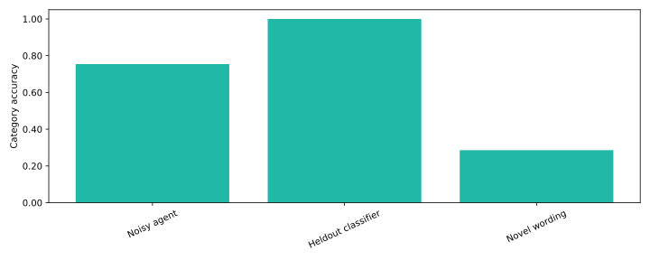

# Support triage evaluation lab

**Can suggested ticket routing improve on noisy manual categories while exposing uncertainty?**

Text classification, account-separated evaluation, confidence-based human review and routing. Built for a applied ai / support analytics portfolio using [Ledgerly](vendor/ledgerly-data/PROVENANCE.md), a fictional B2B SaaS business. All records are synthetic. This is a reproducible portfolio implementation, not a claim of deployed customer impact.



## Try it

Python 3.11 and Git are recommended. Run from this repository’s root.

```bash
python3 -m venv .venv
source .venv/bin/activate
python -m pip install -r requirements.txt
python scripts/bootstrap.py --seed 42
python run.py --data data --out reports
python -m pytest -q
python -m http.server 8000 --directory reports
```

Open http://localhost:8000 for the report. You can inspect the committed [metrics](reports/metrics.json) and CSV reports immediately without installing anything. The HTML report is also committed as [reports/index.html](reports/index.html); download/open locally to view it. GitHub displays its source.

The bootstrap regenerates all synthetic tables locally; source data and databases are ignored by Git. A self-contained, MIT-licensed generator copy is included in `vendor/ledgerly-data`, pinned to commit `339280a4e8ecd67c3d747f5ba560807b41038dc7`. Regeneration uses a deterministic seed within the dependency environment; library upgrades can alter Faker output. Do not substitute real CRM exports into a public commit.

## What to inspect

Inspect evaluation/novel_tickets.csv, confusion_matrix.csv and novel_text_predictions.csv. The novel examples were authored separately from the generator and never enter training or threshold selection.

Outputs go to `reports/`: a standalone HTML dashboard, SVG chart, machine-readable metrics and CSV evidence. Continuous integration runs unit checks, generates fresh seed-42 data and executes the full analysis. The warehouse additionally runs native dbt build/tests. Workflow results are visible in the Actions tab.

## How it works

Ticket text → TF-IDF/logistic baseline trained on noisy agent categories → validation threshold → later unseen-account evaluation → human review or advisory routing.

Training uses pre-2026 tickets from 60% of accounts. Validation uses January–March tickets from another 20%; test uses April–September tickets from the final 20%. Validation chooses a threshold targeting 95% category accuracy with at least 20 samples. Cancellation always requires review.

**Measures:** Category accuracy/macro-F1, confusion matrix, review coverage, accuracy on accepted suggestions and separate novel-wording stress results.

## Seed-42 findings

The synthetic-template test reaches 100% category accuracy versus 75.4% for noisy agent labels. Accuracy drops to 28.6% across fourteen separately authored novel-wording examples; every novel example is sent for human review. The gap is evidence against deploying the baseline as an autonomous classifier.

## Business interpretation

Use the outputs to ask whether the decision is supportable, what could go wrong and which additional evidence would change the recommendation. The reports intentionally retain limitations and unsuccessful cases. Performance on generated data measures implementation behavior; it does not establish performance on a real employer’s data.

## Employer alignment

See [role-fit research](docs/role-fit.md) for salary-transparent job examples overlapping $150–200k, skill requirements and location/seniority caveats. See [design and limitations](docs/design.md) for deployment considerations and a short interview walkthrough.

## Scope and limitations

This is a local ML baseline, not an LLM or autonomous agent. Synthetic templates can inflate results even across accounts and time. Priority and subtle churn signals are not reliably recoverable from generated text and require human review. Suggested route names are illustrative; model confidence is not a correctness guarantee. No helpdesk API writes.

## Authorship

Created for Nick Jungmarker’s portfolio with AI-assisted implementation. The commit history records the actual build; no backdated history or employer outcomes are claimed. Before presenting this as evidence of personal proficiency, reproduce it, review the design and be prepared to explain and modify the code. MIT license; the source generator is MIT licensed.

## Related portfolio projects

- [ledgerly-revenue-warehouse](https://github.com/jungmarker/ledgerly-revenue-warehouse)
- [ledgerly-crm-resolution](https://github.com/jungmarker/ledgerly-crm-resolution)
- [ledgerly-sales-forecast](https://github.com/jungmarker/ledgerly-sales-forecast)
- [ledgerly-churn-radar](https://github.com/jungmarker/ledgerly-churn-radar)
